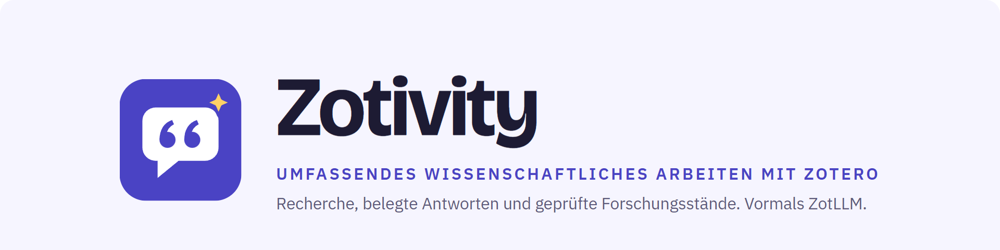
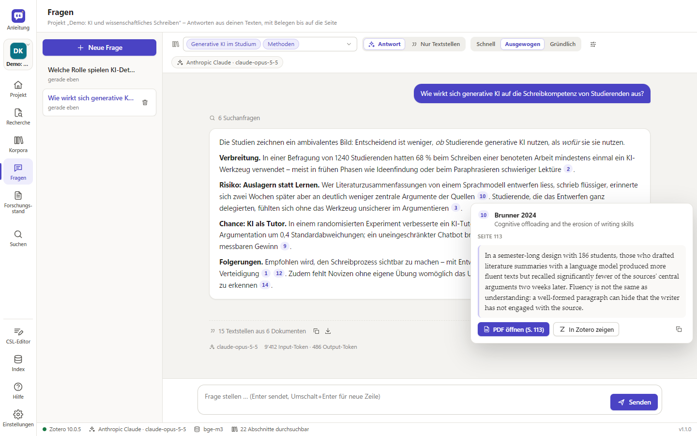
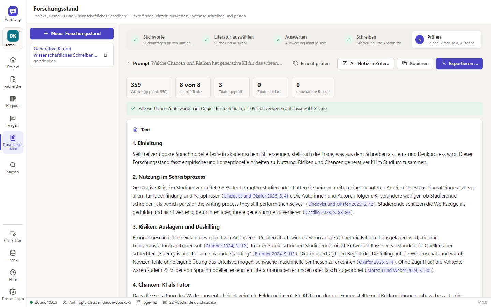
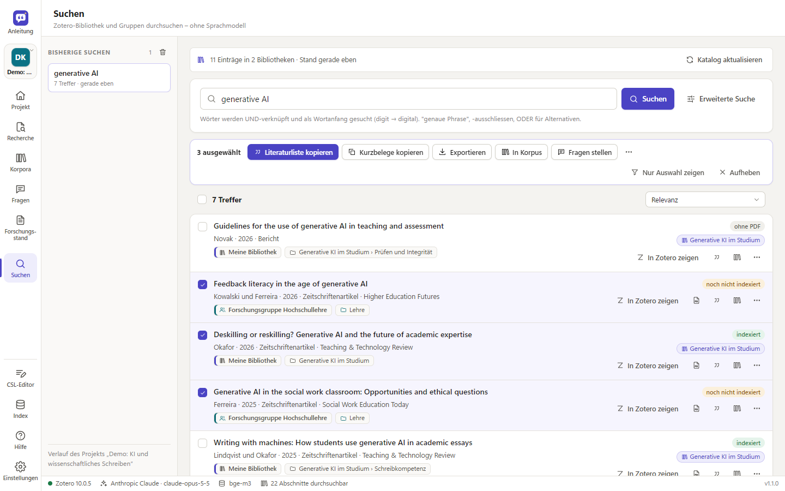

<p align="center">
  <picture>
    <source media="(prefers-color-scheme: dark)" srcset="docs/img/banner-de-dark.png">
    
  </picture>
</p>

<p align="center">
  <a href="https://github.com/avibecoder42/ZotLLM/releases/latest"></a>
  <a href="https://github.com/avibecoder42/ZotLLM/releases"></a>
  
  <a href="LICENSE"></a>
  <a href="#vibe-coded"></a>
</p>

<p align="center"><a href="README.md">English</a> · <b>Deutsch</b></p>

ZotLLM ist ein Programm für den Desktop, das mit Zotero zusammenarbeitet. Die Arbeit ist in **Projekte** gegliedert,
jedes mit eigenen **Wissenskorpora**: Ein Korpus ist eine Auswahl von Zotero-Sammlungen oder ganzen Bibliotheken, auch
aus Gruppen. ZotLLM liest die PDFs, Word-Dokumente und weiteren Texte der Korpora samt Seitenzahlen und indexiert sie auf dem
eigenen Rechner. Fragen und Forschungsstände stützen sich dann genau auf die Texte des Projekts.

<table>
  <tr>
    <td width="33%" valign="top"><br><b>Fragen</b><br>Fragen an die eigenen Texte, beantwortet nur aus den gefundenen Textstellen. Jeder Beleg öffnet die Textstelle mit Seite.</td>
    <td width="33%" valign="top"><br><b>Forschungsstand</b><br>Von der Suchstrategie bis zur geprüften Synthese: Jeder Beleg und jedes wörtliche Zitat wird an den PDFs geprüft.</td>
    <td width="33%" valign="top"><br><b>Suchen</b><br>Schnelle Suche über die eigene Bibliothek und alle Gruppen, ohne Sprachmodell. Literaturangaben im eigenen Zitierstil kopieren oder eine Auswahl exportieren.</td>
  </tr>
</table>

Die Sprachmodelle sind frei wählbar: **Claude, ChatGPT (OpenAI), Gemini, DeepSeek** per API oder lokale Modelle über
**Ollama**. Embedding-Modelle laufen zudem **eingebaut** (llama.cpp), ganz auf dem eigenen Rechner, mit einem geprüften
Modellkatalog. API-Schlüssel liegen verschlüsselt im Schlüsselspeicher des Betriebssystems. Läuft unter Windows; Pfade,
Schlüsselspeicher und Startskripte sind für macOS und Linux angelegt.

Dazu kommt ein **CSL-Editor**: Zitierstil auf zotero.org suchen, per Klick auf die Vorschau anpassen und direkt in
Zotero installieren. Er ist eine erste Version und noch in Entwicklung – Hinweise und Beiträge sind willkommen
([Issues](https://github.com/avibecoder42/ZotLLM/issues)).

Neu in 1.1: **Recherche** – der Schritt vor dem Forschungsstand. Ein Recherche-Projekt führt von der Fragestellung über
Suchstrings für PubMed, OpenAlex und weitere offene Datenbanken (dazu RIS-Import aus lizenzierten wie PsycInfo), einen
Pool ohne Duplikate und ein Screening per Tastatur bis zur ausgewählten Literatur in Zotero-Sammlungen. KI-Vorschläge
sind freiwillig und nutzen das in ZotLLM eingestellte Sprachmodell; entscheiden tust du. Siehe [Recherche](#recherche).

<p align="center"></p>
<p align="center"><sub>Antworten mit Belegen; ein Klick zeigt die Textstelle mit Seite. Demo-Bibliothek mit erfundenen Quellen.</sub></p>

<table>
  <tr>
    <td width="50%" valign="top"><br><sub>Forschungsstand: Jeder Beleg und jedes Zitat wird an den Quellen geprüft</sub></td>
    <td width="50%" valign="top"><br><sub>Suchen ohne Sprachmodell, mit Auswahl zum Kopieren, Exportieren oder Befragen</sub></td>
  </tr>
</table>

<a name="vibe-coded"></a>

> **Vibe-coded.** ZotLLM wurde von **Claude** geschrieben (dem KI-Modell von Anthropic, in Claude Code) – das
> Programm, das Zotero-Plugin, die Installationsskripte, die Tests und die Dokumentation. Initiiert hat das Projekt
> [avibecoder](https://github.com/avibecoder42): avibecoder hat festgelegt, was entsteht, jede Version im Forschungsalltag getestet und über
> jeden nächsten Schritt entschieden; von Hand geschrieben wurde kein Code. Bitte den Code in diesem Bewusstsein lesen:
> Er ist umfangreich getestet (rund 330 automatische Tests), aber nicht Zeile für Zeile von einer Entwicklerin oder
> einem Entwickler geprüft.

> **Als Werkzeug nutzen, nicht als Ersatz für die eigene wissenschaftliche Arbeit.** Siehe
> [Werkzeug statt Ersatz – die Gefahr des Deskilling](#werkzeug-statt-ersatz--die-gefahr-des-deskilling).

ZotLLM ist ein unabhängiges Projekt und steht in keiner Verbindung zu Zotero oder der Corporation for Digital
Scholarship. Zotero ist eine eingetragene Marke der Corporation for Digital Scholarship.

---

## Werkzeug statt Ersatz – die Gefahr des Deskilling

ZotLLM kann suchen, zusammenfassen und Entwürfe schreiben. Genau deshalb kann es die Fähigkeiten schwächen, von
denen wissenschaftliche Arbeit lebt: genau lesen, Befunde gewichten, eine Argumentation aufbauen und in eigenen Worten
schreiben. Je mehr davon man abgibt, desto weniger übt man es.

- **Die wissenschaftliche Arbeit nicht abgeben.** Antworten und Forschungsstände sind Entwürfe aus gefundenen
  Textstellen – keine fertigen Texte. Erzeugten Text nicht als eigene Arbeit einreichen. Die Regeln der eigenen
  Hochschule zum KI-Einsatz beachten und offenlegen, wofür das Werkzeug verwendet wurde.
- **Die Quellen lesen.** Jeder Beleg führt zur Originalstelle (ein Klick öffnet die PDF auf der Seite). Prüfen, ob die
  Aussage dort wirklich steht und richtig wiedergegeben ist: Zusammenhang, Einschränkungen, Stichprobe, Grenzen.
- **Kritisch gegenprüfen.** ZotLLM prüft wörtliche Zitate gegen den PDF-Text – nicht aber sinngemässe Wiedergaben,
  Deutungen oder die Gewichtung von Studien. Sprachmodelle ordnen falsch zu, verallgemeinern zu stark und lassen
  widersprechende Befunde weg. Die Grundlage ist auf die eigene Bibliothek beschränkt und auf das, was die Suche findet.
- **Das Denken selbst behalten.** Fragestellung, Gliederung und Argumentation selbst entwickeln. Das Werkzeug nutzen,
  um Material zu finden, die eigene Lektüre gegenzuprüfen und Übersehenes zu entdecken – und seine Entwürfe mit den
  eigenen vergleichen.

---

## Aufbau

```
Zotero 10 (lokale API)  ←→  ZotLLM-Dienst (Python, 127.0.0.1:23120)   ←→  LLM nach Wahl
  + schlankes Plugin           – Text + Seitenzahlen aus PDF/EPUB/HTML/Word   Claude · GPT · Gemini
    (Rechtsklick, Autostart)   – Zerlegung, Literaturverzeichnisse erkennen   DeepSeek · lokal (Ollama)
                               – Embedding: eingebaut (llama.cpp), Ollama, OpenAI …
Browser / Programmfenster ←→   – SQLite-Index: Volltextsuche + Vektoren
                               – Notizen & Sammlungen zurück nach Zotero
Claude Desktop (MCP) ←→        – MCP-Server
```

- **Kein direkter Zugriff auf `zotero.sqlite`.** Alles läuft über die lokale API von Zotero (Zotero 10 schreibt
  seine Datenbank im WAL-Modus; direkte Leser können unvollständige Daten sehen).
- **Index liegt lokal** (`%LOCALAPPDATA%\ZotLLM`), nicht im synchronisierten Zotero-Ordner.
- **Das Plugin bleibt schlank** (Menüs, Autostart). Zotero ändert bei Hauptversionen oft Plugin-Schnittstellen;
  die eigentliche Arbeit macht deshalb der externe Dienst.

## Installation (Windows)

1. `ZotLLM-Setup-<Version>.exe` unter [Releases](https://github.com/avibecoder42/ZotLLM/releases) herunterladen und
   ausführen (Installation pro Benutzer, keine Adminrechte nötig; ist bereits eine Version installiert, fragt das Setup
   nach Update, Reparatur oder Rückstufung). Das Installationsprogramm wird von GitHub Actions aus dem veröffentlichten
   Quellcode gebaut; jedes Release enthält eine `.sha256`-Datei zur Kontrolle. Es ist **noch nicht signiert**, deshalb
   warnt Windows SmartScreen («Unbekannter Herausgeber»): *Weitere Informationen → Trotzdem ausführen*. Fehlt diese
   Möglichkeit (z. B. auf verwalteten Geschäfts-PCs), die heruntergeladene Datei mit rechter Maustaste → *Eigenschaften*
   → *Zulassen* ankreuzen → *OK* und erneut starten.
2. ZotLLM aus dem Startmenü öffnen. Das Fenster *Einrichtung* führt Schritt für Schritt durch die Einrichtung.

Embedding-Modelle führt ZotLLM selbst aus (llama.cpp ist im Installationsprogramm enthalten); die Modelle selbst
werden erst in den Einstellungen per Knopf heruntergeladen. Optional: [Ollama](https://ollama.com) für lokale
Sprachmodelle. Benötigt wird die Microsoft-Edge-WebView2-Laufzeit (in Windows 10/11 enthalten; das Setup warnt, falls
sie fehlt).

**Verhalten des Programms:** Ein zweiter Start holt das offene Fenster nach vorne. Wird beim Schliessen noch indexiert,
fragt ZotLLM, ob im Hintergrund weitergearbeitet werden soll. Startet das Zotero-Plugin ZotLLM, läuft es ohne
Fenster im Hintergrund und endet einige Minuten nach Zotero; «ZotLLM öffnen» in Zotero zeigt das Fenster.
Beenden jederzeit unter *Einstellungen → Programm & Daten*.

**Updates:** Unter *Einstellungen → Programm & Daten* eine Update-Quelle eintragen – HTTPS-Adresse oder Netzwerkpfad
zur Datei `zotllm-update.json`, die beim Build neben dem Installer entsteht. ZotLLM prüft beim Start, lädt den
Installer, kontrolliert die SHA-256-Prüfsumme, installiert unbeaufsichtigt und startet neu. Einstellungen, Index,
Korpora und Schlüssel bleiben erhalten (auch bei der Deinstallation).

**Installer bauen:** `.\packaging\build.ps1` (Tests → Symbole → PyInstaller → Selbsttest der EXE inkl. Fenster →
Inno Setup 6 → Update-Manifest). Mit `-UpdateBaseUrl https://…` steht die Download-Adresse im Manifest.
Releases baut GitHub Actions ([`release.yml`](.github/workflows/release.yml)), sobald ein Versions-Tag `v*` hochgeladen
wird; die Release-Notes sind der Abschnitt der Version im [Changelog](CHANGELOG.md) plus
[`packaging/release-footer.md`](packaging/release-footer.md).

Entwicklung ohne Installer: `install.bat`, dann `start.bat` (Browser) bzw. `.venv\Scripts\zotllm-app.exe` (Fenster).
macOS/Linux: `./install.sh`, danach `./start.sh`.

## Zotero vorbereiten

1. **Lokale API aktivieren:** Zotero → Einstellungen → Erweitert →
   «Anderen Anwendungen auf diesem Computer erlauben, mit Zotero zu kommunizieren».
2. **Plugin installieren (optional, empfohlen):** In ZotLLM unter *Einstellungen → Zotero und Export → Plugin
   speichern*, dann in Zotero *Werkzeuge → Plugins → Zahnrad → Plugin aus Datei installieren …*.
   Das Plugin bringt Rechtsklick-Menüs («Sammlung indexieren», «Fragen zu ausgewählten Einträgen»,
   «Auswertungsblätter erstellen») und startet den Dienst automatisch mit Zotero, sobald er einmal lief.
   Neue Plugin-Versionen werden durch erneutes Installieren der `.xpi` eingespielt (Zotero akzeptiert nur
   HTTPS-Update-Adressen, der lokale Dienst spricht aber nur HTTP). Die Einrichtungs-Checkliste meldet ein veraltetes
   Plugin.
3. **Schreibzugriff freigeben (für Notizen und Sammlungen):** *Einstellungen → Zotero und Export → Schreibzugriff
   freigeben*. Zotero zeigt eine Rückfrage – «Entscheidung merken» wählen, sonst gilt die Freigabe nur bis zum
   nächsten Neustart. **Der Dialog kann hinter anderen Fenstern liegen**; ZotLLM versucht ihn nach vorne zu holen,
   sonst in der Taskleiste auf Zotero klicken.

## Projekte

Ein **Projekt** bündelt Wissenskorpora, Chats und Forschungsstände. Der Umschalter oben in der linken Leiste (Strg+P)
zeigt das aktive Projekt; *Projekt*, *Fragen*, *Forschungsstand* und *Korpora* beziehen sich darauf. *Index* und
*Einstellungen* gelten für alle Projekte.

- **Korpora werden geteilt:** Ein Korpus kann in mehreren Projekten vorkommen; der Index ist gemeinsam, jeder Text wird
  nur einmal eingebettet.
- **Speichern geschieht laufend.** «Als Datei speichern» exportiert ein Projekt als `.zllm` (Korpus-Definitionen, Chats,
  Forschungsstände, Auswertungsblätter, Suchverlauf – ohne Index und ohne Schlüssel); «Projekt importieren» lädt es
  wieder, auch auf einem anderen Rechner.
- **Reihenfolge und Archiv:** Projektkacheln lassen sich ziehen; abgeschlossene Projekte lassen sich archivieren (nichts
  wird gelöscht) und jederzeit zurückholen.

## Erste Schritte

Der erste Start (und jeder Start, solange Schritte der Einrichtung offen sind) beginnt im Fenster **Einrichtung**; sonst öffnet ZotLLM das zuletzt offene Projekt in der zuletzt benutzten Ansicht. Die Einrichtung zeigt oben *Alle Projekte*, *Neues Projekt* und *Projekt importieren*,
darunter die Einrichtungs-Checkliste mit dem nächsten offenen Schritt hervorgehoben. Alle Seitenleisten lassen sich in
der Breite ziehen (Doppelklick: Standardbreite).

1. **Sprachmodelle** (*Einstellungen → Sprachmodelle*): Anbieter wählen, Schlüssel speichern. Ist für den eingestellten
   Anbieter kein Schlüssel da, stellt ZotLLM automatisch auf einen Anbieter mit Schlüssel um. «Verbindung testen»
   prüft Schlüssel und Modell.
2. **Embedding-Modell** (*Einstellungen → Embedding*): Standard ist *Eingebaut* mit `bge-m3`. Der Modellkatalog zeigt
   geprüfte Modelle mit Stärken, Fächern, Zeit pro 100 Seiten auf diesem Rechner und Speicherbedarf; **Herunterladen**
   lädt eines (fortsetzbar, mit Prüfsumme), ein Kurztest misst danach Tempo und Suchqualität. Weitere GGUF-Modelle
   lassen sich auf Hugging Face nach Namen suchen. Ein bestehender Ollama-Index desselben Modells wird nach einer
   Stichprobe übernommen statt neu berechnet.
3. **Wissenskorpora** (*Korpora*): Abbild der eigenen Bibliothek und aller Gruppen mit Sammlungen und Untersammlungen.
   Sammlungen oder ganze Bibliotheken anhaken, Korpus benennen, speichern. Indexiert wird genau die Vereinigung aller
   Korpora.
4. **Index:** aktueller Text, Fortschritt, Restzeit, nächste und zuletzt verarbeitete Texte, Probleme (z. B. Scans ohne
   Text). Eine **Warteschlange** nimmt weitere Läufe auf, solange einer läuft. Wahlweise automatisch im Hintergrund.
5. **Fragen:** Antwort mit anklickbaren Belegen `[3]` (Vorschau mit «PDF öffnen (S. x)» und «In Zotero zeigen»);
   die Textstellen stehen darunter, jeweils mit **Relevanz**. «Nur Textstellen» sucht ohne LLM.

Tastatur: Strg+1–5 Ansichten des Projekts, Strg+6 Index, Strg+, Einstellungen, F1 Hilfe, Strg+P Projekt wechseln.
Darstellung: System, Hell, Grau, Dunkel (die Titelleiste des Fensters passt sich an).

### Suchen (ohne Sprachmodell)

*Suchen* durchsucht die eigene Bibliothek und alle Gruppen – schnell, kostenlos, auch ohne laufendes Zotero. Grundlage
ist ein lokaler Katalog der Metadaten aller Bibliotheken, der Änderungen in Zotero selbst nachführt.

- **Einfeld:** Titel, Personen, Publikation, Schlagwörter, Abstract, DOI. Wörter UND-verknüpft und als Wortanfang
  (`digit` → «digital»), `"genaue Phrase"`, `-ausschliessen`, `ODER`/`OR`.
- **Mehrfeld:** einzelne Felder, Volltext der indexierten Texte (mit Fundstelle), Jahr von–bis, Eintragsart,
  Bibliotheken, Sammlung inkl. Untersammlungen, «nur mit PDF», «nur indexierte Texte».
- **Treffer** zeigen ihren Ort in Zotero, den Indexierstand und die Korpora des Projekts, in denen sie schon sind.
  Aktionen: in Zotero zeigen, PDF öffnen, **Literaturnachweis kopieren** (im eingestellten Zitierstil, formatiert für
  Word), in Korpus aufnehmen und weitere im Menü ⋯.
- **Auswahl** (bleibt über mehrere Suchen erhalten; Shift+Klick, Strg+A, Esc): Literaturliste und Kurzbelege kopieren,
  Export als Word (Zotero-Felder), BibTeX, RIS oder Markdown, in Korpus aufnehmen, **Fragen stellen** zu genau diesen
  Einträgen, in eine Zotero-Sammlung ablegen.

### Export nach Word und LaTeX

Antworten, Textstellen und Forschungsstände lassen sich kopieren (als Text oder formatiert für Word) und speichern:

- **Word (.docx):** Belege und Literaturverzeichnis sind **Zotero-Felder** (`ADDIN ZOTERO_ITEM CSL_CITATION` /
  `ZOTERO_BIBL`) samt Dokumenteinstellungen – im Zotero-Reiter von Word «Refresh» klicken, danach wie selbst
  eingefügte Belege bearbeiten und den Stil wechseln.
- **LaTeX (.tex):** `\parencite[S.~12]{…}` und die BibTeX-Daten aus Zotero in `filecontents` – eine Datei, direkt mit
  pdflatex/lualatex und biber übersetzbar.
- **Markdown (.md).** Zitierstil: *Einstellungen → Zotero und Export* – alle in Zotero installierten Stile.
- **Seitenzahlen:** Belege nennen die gedruckte Seite (Kopf-/Fusszeile, Gegenprobe mit dem Zotero-Feld «Seiten»), nicht
  die Dateiseite; Quellen ohne Seitenzahlen «o. S.», je nach Stil gesetzt.

### Sprache und Hilfe

Oberfläche und Hilfe gibt es auf Deutsch und Englisch (*Einstellungen → Sprache*), getrennt davon die Sprache der
KI-Ausgaben. Weitere Sprachen: Wörterbuch `server/static/js/i18n/<code>.js` (Schlüssel sind die deutschen Texte),
Meldungen des Dienstes `zotllm/locales/<code>.py`, Handbuch `server/static/help/<code>.md`. Die **Hilfe** (F1) ist
ein Handbuch mit Inhaltsverzeichnis und Volltextsuche.

### Wie lange dauert das Indexieren?

Gemessen auf einem Referenz-Laptop (Ryzen 7 5800U, 16 GB): `bge-m3` eingebaut oder über Ollama ≈ 400–470 Tokens/s,
also rund 3 Minuten pro 100 Seiten. Der Modellkatalog zeigt diese Zeit für jedes Modell – von unter einer Minute
(Granite 97M) bis rund 30 Minuten (Qwen3-Embedding 4B) pro 100 Seiten. Eine Bibliothek mit ≈ 3000 PDFs bräuchte lokal
grob 30–40 Stunden, im Hintergrund über mehrere Abende verteilbar und jederzeit fortsetzbar. Alternativen:
sammlungsweise indexieren, ein kleineres Modell aus der Gruppe *Schnell* oder Cloud-Embeddings (schnell, aber alle
Texte gehen an den Anbieter).

Indexieren besteht aus *Lesen* (Text, Seitenzahlen, Abschnitte) und *Einbetten* (das Embedding-Modell rechnet jeden
Abschnitt in einen Vektor um). Ein Modellwechsel verwirft nichts: Jedes Modell hat einen eigenen Vektorraum, die Texte
werden nicht neu gelesen, nur für das neue Modell eingebettet.

### Grosse Bibliotheken

- Jeder Text wird sofort gespeichert; ein Absturz oder Abbruch verliert höchstens den laufenden Text.
- Texte werden in einem eigenen Prozess mit Zeitlimit gelesen – eine defekte PDF wird als Fehler markiert, die
  Indexierung läuft weiter.
- Kurze Ausfälle des Embedding-Dienstes werden überbrückt; der Rechner bleibt wach; der Speicherplatz wird geprüft.
- Hintergrundmodus in Etappen (Zeitfenster, Höchstzahl Texte pro Lauf), Sicherungen des Index, Warteschlange.
- **Dubletten:** Dasselbe Werk in mehreren Bibliotheken wird an der DOI bzw. an Titel, Erstautor/in und Jahr erkannt;
  nur eine Kopie wird gelesen und verwendet. Vor einem Lauf von Hand fragt ZotLLM, welche.
- Belege auf in Zotero gelöschte Einträge werden auf eine verbleibende Kopie desselben Werks umgestellt.

## Recherche

Die Ansicht **Recherche** (Strg+2) führt eine Literatursuche von der Fragestellung bis zur ausgewählten Literatur in
Zotero. Jede Recherche gehört zu einem ZotLLM-Projekt (die Projektseite zeigt ihren Stand); die Daten liegen in `research.db` im Datenordner.

| Reiter | Was geschieht |
|---|---|
| Projekt | Fragestellung, Kurzbeschreibung, Ein- und Ausschlusskriterien |
| Datenbanken | Disziplinen wählen; die App schlägt Datenbanken aus ihrem Katalog vor (Zugang, Bedingungen, Schlüssel) |
| Suchstrategie | Konzeptblöcke → Suchstrings je Datenbank, mit Trefferzahl live |
| Suche & Import | versionierte Suchstrings; Suche in PubMed, OpenAlex, Europe PMC, ERIC, EconBiz, Semantic Scholar, arXiv, OSF-Preprints und swisscovery; RIS-Import aus Ovid, EBSCO oder Web of Science |
| Pool | Treffer ohne Duplikate (DOI, PMID, OpenAlex-ID, Titel), Abgleich mit der Zotero-Zielbibliothek, Vorfilter, Grenzfälle, fehlende Abstracts nachladen, Recall-Check mit Schlüsselarbeiten |
| Ordner | Zielbibliothek und Ordner 1–20 (Kürzel 1–9), je einer Zotero-Sammlung zugeordnet |
| Screening | Karten (J/K blättern, 1–9 Ordner, X ausschliessen, ? unsicher, G Grenzfall, A KI-Vorschlag übernehmen, Z rückgängig) oder Liste mit Sammel-Übernahme |
| Übergabe | Plan je Ordner, dann nach Zotero – nur nach ausdrücklicher Bestätigung; Suchprotokoll als Markdown/CSV im Stil von PRISMA-S |

- **Nichts verschwindet still:** Vorfilter markieren nur; Treffer mit einem Ausnahmebegriff werden Grenzfälle,
  Ausgeblendete lassen sich prüfen und zurückholen.
- **KI-Vorschläge sind freiwillig** (Screening, Datenbanken, Konzeptblöcke, Unterordner) und nutzen das Modell der
  Vorauswahl im Forschungsstand (*Einstellungen → Experten → Forschungsstand*: Hilfs- oder Hauptmodell). Gesendet
  werden nur Titel, Zeitschrift, Jahr und Abstract sowie der Projekttext; vor jedem Lauf zeigt die App die geschätzten
  Token und – mit eingetragenen Preisen – die Kosten. Entschieden wird von Hand; Vorschlag und Entscheid stehen beide
  im Protokoll.
- **Datenbanken nur auf legalem Weg:** offizielle Schnittstellen, von der Hochschule freigeschaltete Zugänge oder
  RIS-Export von Hand – keine Browser-Automatisierung.
- **Zotero:** lokal über die API von Zotero (Schreibfreigabe wie im übrigen ZotLLM) oder über die Zotero-Web-API.
  Schlüssel für die Web-API und die Datenbanken liest die App aus dem Schlüsselspeicher (`zotero-web`, `openalex` –
  bei OpenAlex seit Februar 2026 nötig –, `ncbi`, `semanticscholar`); eine Einstellungsseite zum Eintragen ist geplant.

## Forschungsstand

Für Fragen wie «Erarbeite den Forschungsstand zu … in 4000 Wörtern» reicht eine einfache Suche nicht. Der Modus
arbeitet in fünf Schritten:

1. **Stichworte:** Das Hilfsmodell schlägt Suchanfragen vor (Deutsch/Englisch, Synonyme, Fachbegriffe), die man
   prüft, ändert, ergänzt oder löscht – wie Suchstrings in Literaturdatenbanken. Treffer werden je Dokument gezählt; je
   Anfrage sieht man, wie viele Texte sie gefunden hat und wie viele *nur* sie.
2. **Literatur auswählen:** Das Hilfsmodell schlägt eine Auswahl mit Begründung vor; man prüft sie selbst, auf Wunsch
   als Zotero-Sammlung.
3. **Einzeln auswerten:** Für jeden Text entsteht ein Auswertungsblatt (Fragestellung, Theorie, Methode, Stichprobe,
   Land, Befunde, Grenzen, Kernzitate mit Seitenzahl) – gespeichert im Index und als Notiz am Zotero-Eintrag. Vor dem
   Start stehen Input-, Output- und Denk-Token und – mit eingetragenen Preisen – die geschätzten Kosten.
4. **Synthese:** Gliederung (bearbeitbar), dann abschnittsweises Schreiben mit Belegen `[@SCHLÜSSEL, S. x]`.
5. **Kontrolle:** Jeder Beleg wird gegen die ausgewählten Texte geprüft, wörtliche Zitate gegen den Originaltext;
   abgebrochene Abschnitte werden erkannt und lassen sich neu schreiben. Ausgabe als Markdown, Word, LaTeX oder Notiz in
   Zotero, mit einem Anhang zur Methode der Literatursuche (Korpora, Suchanfragen, Treffer).

Das Ergebnis ist ein belegter **Entwurf** auf Basis *deiner* Bibliothek; Gewichtung, kritische Einordnung und der
endgültige Text bleiben deine Arbeit (siehe [die Gefahr des Deskilling](#werkzeug-statt-ersatz--die-gefahr-des-deskilling)).

## Datenschutz und Sicherheit

- **API-Schlüssel** liegen im Schlüsselspeicher des Systems: Windows-Anmeldeinformationsverwaltung (DPAPI, an das
  Benutzerkonto gebunden), macOS-Schlüsselbund, Linux Secret Service. Sie erscheinen nie in Dateien, Logs oder der
  Oberfläche (nur maskiert). Ohne sicheren Speicher werden sie nicht gespeichert; dann Umgebungsvariablen nutzen
  (`ANTHROPIC_API_KEY`, `OPENAI_API_KEY`, `GEMINI_API_KEY`, `DEEPSEEK_API_KEY`).
- **Der Dienst lauscht nur auf 127.0.0.1**, prüft den Host gegen DNS-Rebinding und verlangt für schreibende Anfragen
  einen eigenen Header (Schutz gegen CSRF).
- **Was das Gerät verlässt:** Bei Cloud-LLMs die gefundenen Textstellen (beim Forschungsstand die Texte der
  ausgewählten Dokumente); bei Cloud-Embeddings alle indexierten Texte. Mit eingebautem Embedding (oder Ollama) und
  Ollama als LLM bleibt alles lokal. Hugging Face wird nur für Downloads per Knopf und die Namenssuche angefragt.
  Die Recherche sendet Suchstrings an die gewählten Datenbanken und für KI-Vorschläge Titel und Abstracts der Treffer
  sowie den Projekttext an das Sprachmodell.
- **Downloads** von Modellen sind mit Commit und SHA-256 festgelegt; die eingebaute Laufzeit nimmt nur Anfragen mit dem
  zufälligen Schlüssel von ZotLLM an.

## Kommandozeile

```
.venv\Scripts\python -m zotllm serve --open          Dienst + Oberfläche
.venv\Scripts\python -m zotllm status                Zustand
.venv\Scripts\python -m zotllm keys set anthropic    Schlüssel verdeckt eingeben
.venv\Scripts\python -m zotllm index --collection users/0:ABCD1234
.venv\Scripts\python -m zotllm search "Chatbots Jugendliche"
.venv\Scripts\python -m zotllm ask "Was schreiben meine Quellen über …?"
.venv\Scripts\python -m zotllm mcp                    MCP-Server (stdio)
```

Die installierte `ZotLLM.exe` versteht dieselben Befehle (`ZotLLM.exe mcp`, `… status`, `… index`).

## Claude Desktop (MCP)

In `claude_desktop_config.json`:

```json
{ "mcpServers": { "zotllm": {
    "command": "C:\\Users\\<name>\\AppData\\Local\\Programs\\ZotLLM\\ZotLLM.exe",
    "args": ["mcp"] } } }
```

Werkzeuge: `search_library`, `list_collections`, `get_item`, `get_sheet` – Claude kann mehrfach mit eigenen Begriffen
suchen und mit Seitenzahl und Zotero-Link zitieren.

## Fehlerbehebung

- **«Lokale API aus»:** Option in Zotero aktivieren (siehe oben); Zotero muss laufen.
- **«Die Erweiterung konnte nicht installiert werden …»:** Zotero zeigt diese Sammelmeldung bei jedem
  Installationsfehler – aktuelle `.xpi` unter *Einstellungen → Zotero und Export* neu speichern und installieren.
- **Embedding-Fehler «noch nicht heruntergeladen»:** Unter *Einstellungen → Embedding* das Modell herunterladen. Bei
  Ollama: `ollama pull bge-m3`.
- **Eingebaute Laufzeit startet nicht:** Fehlt eine Programmdatei (z. B. von einem Virenscanner entfernt), ZotLLM
  neu installieren. Ladefehler eines Modells stehen in `Logs\llama-<Modell>.log`.
- **Dokumente «ohne Text»:** Scans ohne Textebene. Texterkennung über *Einstellungen → Experten → Einlesen → OCR*
  (benötigt eine Tesseract-Installation) oder die PDFs vorher mit OCR versehen.
- **Logs:** `%LOCALAPPDATA%\ZotLLM\Logs\zotllm.log`.
- **Zotero-Datenordner in einem Cloud-Ordner** (OneDrive, Dropbox …): Zotero rät davon ab, weil das die Datenbank
  beschädigen kann; besser die Zotero-eigene Synchronisation verwenden. ZotLLM ist davon nicht betroffen (liest nur
  über die API).

## Entwicklung

```
uv pip install --python .venv\Scripts\python.exe -e ".[dev]"
.venv\Scripts\python -m pytest
```

Die Tests laufen ohne Zotero, ohne Modell-Downloads und ohne API-Kosten: Sie simulieren die lokale Zotero-10-API
(inklusive Schreibrechte), erzeugen PDFs, ersetzen LLMs durch Attrappen und `llama-server` durch
`tests/fake_llama_server.py`. Für die eingebaute Laufzeit beim Entwickeln einmal `python packaging/fetch_llama.py`
ausführen.

```
src/zotllm/
  zotero/      Client für die lokale API (Lesen, Schreiben, Autorisierung)
  extract/     PDF/EPUB/HTML/Word/ODT-Text mit Seitenzahlen, Chunking, Literaturverzeichnis-Erkennung
  embeddings/  eingebaut (llama.cpp: Laufzeit, Katalog, Download, Kurztest, Namenssuche), Ollama, OpenAI, Gemini, …
  llm/         Anthropic, OpenAI/DeepSeek/Ollama, Gemini – gemeinsame Schnittstelle
  index/       SQLite (FTS5 + Vektoren je Embedding-Raum), Indexierer, Dubletten
  retrieval/   Hybride Suche (RRF), MMR, Reranking
  rag/         Fragen, Forschungsstand, Quellen
  research/    Recherche: Datenbanken, Suchstrings, Pool, Screening, Übergabe nach Zotero (/api/research/…);
               kennt ZotLLM nicht – research_adapters.py verbindet (Zotero-Client, Schlüsselspeicher, Sprachmodelle)
  server/      FastAPI + Oberfläche (static/: js, css, help/<Sprache>.md)
  plugin/      Zotero-Plugin (wird vom Dienst als .xpi ausgeliefert)
  locales/     Meldungen des Dienstes je Sprache
```

Änderungen je Version: [CHANGELOG.md](CHANGELOG.md) (auf Englisch).

## Lizenz

[MIT](LICENSE). Ohne Gewähr – siehe Lizenztext.
