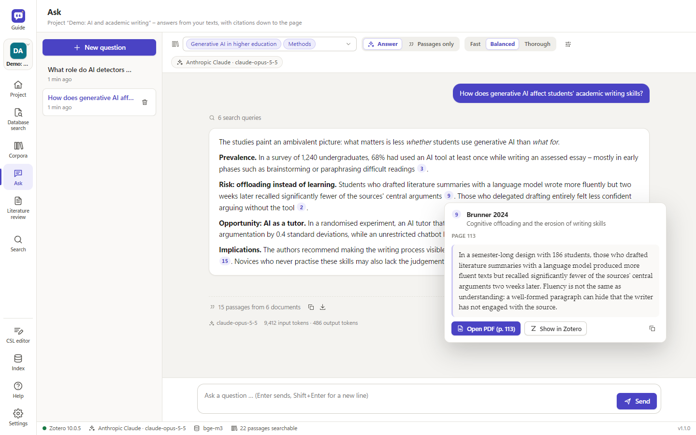
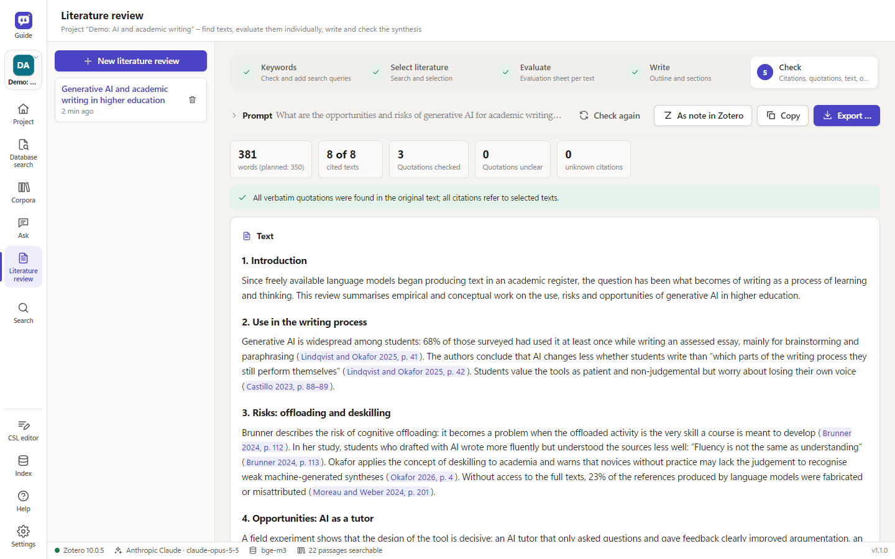
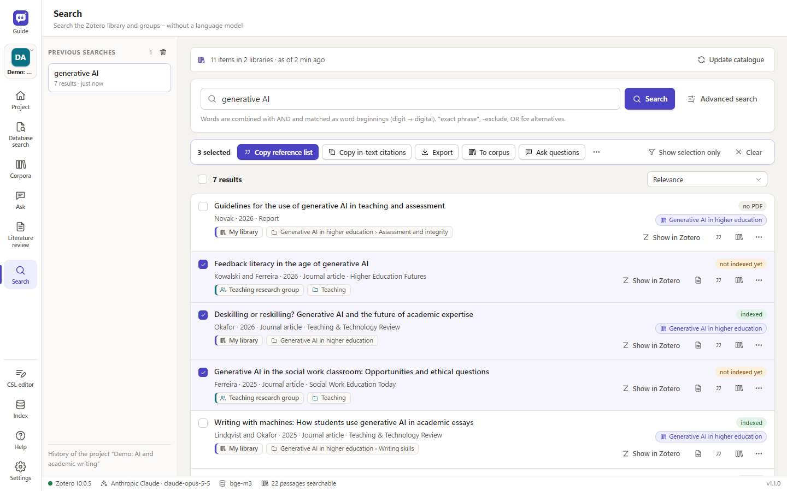

<p align="center">
  <picture>
    <source media="(prefers-color-scheme: dark)" srcset="docs/img/banner-en-dark.png">
    
  </picture>
</p>

<p align="center">
  <a href="https://github.com/avibecoder42/ZotLLM/releases/latest"></a>
  <a href="https://github.com/avibecoder42/ZotLLM/releases"></a>
  
  <a href="LICENSE"></a>
  <a href="#vibe-coded"></a>
</p>

<p align="center"><b>English</b> · <a href="README.de.md">Deutsch</a></p>

ZotLLM is a desktop application that works alongside Zotero. You organise your work in **projects**, each with its own
**knowledge corpora**: a corpus is a selection of Zotero collections or whole libraries, group libraries included.
ZotLLM reads the PDFs, Word documents and other texts of the corpora, keeps their page numbers and indexes them on your
computer. Questions and literature reviews then draw on exactly the texts that belong to the project.

<table>
  <tr>
    <td width="33%" valign="top"><br><b>Ask</b><br>Questions about your own texts, answered only from the retrieved passages. Every citation opens the passage and its page.</td>
    <td width="33%" valign="top"><br><b>Literature review</b><br>From search strategy to a checked synthesis: every citation and verbatim quotation is verified against the PDFs.</td>
    <td width="33%" valign="top"><br><b>Search</b><br>Fast search across your library and groups, without a language model. Copy references in your citation style or export a selection.</td>
  </tr>
</table>

Language models are your choice: **Claude, ChatGPT (OpenAI), Gemini, DeepSeek** via API, or local models via
**Ollama**. Embedding models also run **built in** (llama.cpp), entirely on your computer, with a curated model catalog.
API keys are stored encrypted in the operating system's key store. Runs on Windows; paths, key storage and start
scripts are prepared for macOS and Linux.

Also included: a **CSL editor** to find a citation style on zotero.org, adapt it by clicking on the preview and install
it directly in Zotero. It is a first version and still in development – feedback and contributions are welcome
([issues](https://github.com/avibecoder42/ZotLLM/issues)).

New in 1.1: **Literature search** – the step before the literature review. A search project leads from the research
question through search strings for PubMed, OpenAlex and other open databases (plus RIS import from licensed ones such
as PsycInfo), a de-duplicated pool and keyboard screening to the selected literature in Zotero collections. Optional AI
suggestions use the language model set in ZotLLM; the decisions are always yours. See
[Literature search](#literature-search).

<p align="center"></p>
<p align="center"><sub>Answers with citations; a click shows the passage and its page. Demo library with fictitious sources.</sub></p>

<table>
  <tr>
    <td width="50%" valign="top"><br><sub>Literature review: every citation and quotation checked against the sources</sub></td>
    <td width="50%" valign="top"><br><sub>Search without a language model, with a selection to copy, export or ask about</sub></td>
  </tr>
</table>

<a name="vibe-coded"></a>

> **Vibe-coded.** ZotLLM was written by **Claude** (Anthropic's AI model, working in Claude Code) – the
> application, the Zotero plugin, the installer scripts, the tests and the documentation. The project's initiator,
> [avibecoder](https://github.com/avibecoder42), defined what to build, tested every version in day-to-day research and decided
> on each next step; no code was written by hand. Read the code with that in mind: it is extensively tested
> (≈ 330 automated tests), but it has not been reviewed line by line by a human developer.

> **Use it as a tool, not as a replacement for your own scholarly work.** See
> [Use it as a tool – the risk of deskilling](#use-it-as-a-tool--the-risk-of-deskilling).

ZotLLM is an independent project, not affiliated with or endorsed by Zotero or the Corporation for Digital Scholarship.
Zotero is a registered trademark of the Corporation for Digital Scholarship.

---

## Use it as a tool – the risk of deskilling

ZotLLM can search, summarise and draft. That is exactly why it can wear down the abilities research depends on:
reading closely, weighing evidence, building an argument and writing in your own voice. The more of this you hand
over, the less of it you practise.

- **Do not hand over your scholarly work.** Answers and literature reviews are drafts built from retrieved passages –
  not finished texts. Do not submit generated text as your own work. Follow your institution's rules on AI use and
  disclose where you used it.
- **Read the sources.** Every citation leads to the original passage (a click opens the PDF at the page). Check that
  the statement is really there and correctly represented: context, hedging, sample, limitations.
- **Verify critically.** ZotLLM checks verbatim quotations against the PDF text – it does not check paraphrases,
  interpretations or how studies are weighted. Language models misattribute, overgeneralise and leave out
  contradicting findings. The evidence is limited to your library and to what the search found.
- **Keep the thinking yours.** Formulate the question, the structure and the argument yourself. Use the tool to find
  material, to cross-check your reading and to spot what you overlooked – and compare its drafts with your own.

---

## Architecture

```
Zotero 10 (local API)  ←→  ZotLLM service (Python, 127.0.0.1:23120)  ←→  LLM of your choice
  + slim plugin               – text + page numbers from PDF/EPUB/HTML/Word   Claude · GPT · Gemini
    (context menu, autostart) – chunking, reference-list detection            DeepSeek · local (Ollama)
                              – embedding: built in (llama.cpp), Ollama, OpenAI …
Browser / app window  ←→      – SQLite index: full-text search + vectors
                              – notes & collections back to Zotero
Claude Desktop (MCP)  ←→      – MCP server
```

- **No direct access to `zotero.sqlite`.** Everything goes through Zotero's local API (Zotero 10 writes its database
  in WAL mode; direct readers may see incomplete data).
- **The index is local** (`%LOCALAPPDATA%\ZotLLM`), not in the synchronised Zotero folder.
- **The plugin stays slim** (menus, autostart). Zotero often changes plugin interfaces between major versions, so the
  actual work is done by the external service.

## Installation (Windows)

1. Download `ZotLLM-Setup-<version>.exe` from [Releases](https://github.com/avibecoder42/ZotLLM/releases) and run it
   (per-user installation, no administrator rights needed; if a version is already installed, the setup offers update,
   repair or downgrade). The installer is built by GitHub Actions from the published source code, and each release
   contains a `.sha256` file to check the download. It is **not code-signed yet**, so Windows SmartScreen warns
   ("Unknown publisher"): click *More info → Run anyway*. If that option is missing (e.g. on managed PCs), right-click
   the downloaded file → *Properties* → tick *Unblock* → *OK*, then start it again.
2. Open ZotLLM from the Start menu. The *Setup* window guides you step by step.

ZotLLM runs embedding models itself (llama.cpp is included in the installer); the models are downloaded later with
a button in the settings. Optional: [Ollama](https://ollama.com) for local language models. The Microsoft Edge
WebView2 runtime is required (included in Windows 10/11; the setup warns if it is missing).

**Behaviour:** starting it a second time brings the open window to the front. If indexing is still running when you
close the window, ZotLLM asks whether to continue in the background. If the Zotero plugin starts ZotLLM, it runs
without a window and ends a few minutes after Zotero; "Open ZotLLM" in Zotero shows the window.

**Updates:** under *Settings → Program & data*, enter an update source – an HTTPS address or network path to the file
`zotllm-update.json` that the build creates next to the installer. ZotLLM checks at start-up, downloads the
installer, verifies its SHA-256 checksum, installs silently and restarts. Settings, index, corpora and keys are kept
(also when uninstalling).

**Building the installer:** `.\packaging\build.ps1` (tests → icons → PyInstaller → self-test of the EXE including the
window → Inno Setup 6 → update manifest). With `-UpdateBaseUrl https://…` the download address goes into the manifest.
Releases are built by GitHub Actions ([`release.yml`](.github/workflows/release.yml)) when a version tag `v*` is pushed;
the release notes are the version's section of the [changelog](CHANGELOG.md) plus
[`packaging/release-footer.md`](packaging/release-footer.md).

Development without an installer: `install.bat`, then `start.bat` (browser) or `.venv\Scripts\zotllm-app.exe`
(window). macOS/Linux: `./install.sh`, then `./start.sh`.

## Preparing Zotero

1. **Enable the local API:** Zotero → Settings → Advanced → "Allow other applications on this computer to communicate
   with Zotero".
2. **Install the plugin (optional, recommended):** in ZotLLM, *Settings → Zotero and export → Save plugin*, then in
   Zotero *Tools → Plugins → gear → Install plugin from file …*. The plugin adds context menus ("Index collection",
   "Ask about selected items", "Create evaluation sheets") and starts the service together with Zotero once it has run.
   New plugin versions are installed by installing the `.xpi` again (Zotero only accepts HTTPS update addresses, the
   local service speaks HTTP). The setup checklist reports an outdated plugin.
3. **Grant write access (for notes and collections):** *Settings → Zotero and export → Grant write access*. Zotero asks
   for confirmation – choose "Remember my decision", otherwise access lasts only until the next restart. **The dialog
   may be hidden behind other windows**; ZotLLM tries to bring it to the front, otherwise click Zotero in the
   taskbar.

## Projects

A **project** bundles knowledge corpora, chats and literature reviews. The switcher at the top of the left bar
(Ctrl+P) shows the active project; *Project*, *Ask*, *Literature review* and *Corpora* refer to it. *Index* and
*Settings* apply to all projects.

- **Corpora are shared:** a corpus can belong to several projects; the index is shared and every text is embedded only
  once.
- **Saving is continuous.** "Save as file" exports a project as `.zllm` (corpus definitions, chats, literature reviews,
  evaluation sheets, search history – without index and without keys); "Import project" loads it again, also on another
  computer.
- **Manual order and archive:** project tiles can be dragged into order; finished projects can be archived (nothing is
  deleted) and restored at any time.

## First steps

Every start begins in the **Setup** window: *All projects*, *New project* and *Import project* at the top, the setup
checklist below with the next open step highlighted. All side panels can be resized (double-click: default width).

1. **Language models** (*Settings → Language models*): choose a provider and store its key. If the chosen provider has
   no key but another one has, ZotLLM switches automatically. "Test connection" checks key and model.
2. **Embedding model** (*Settings → Embedding*): default is *Built in* with `bge-m3`. The model catalog shows curated
   models with strengths, disciplines, time per 100 pages on this computer and memory needs; **Download** fetches one
   (resumable, checksum-verified), and a short test then measures speed and retrieval quality. More GGUF models can be
   found on Hugging Face by name. An existing Ollama index of the same model is adopted after a sample check instead of
   being recomputed.
3. **Knowledge corpora** (*Corpora*): a mirror of your library and all groups with collections and sub-collections.
   Tick collections or whole libraries, name the corpus, save. Exactly the union of all corpora is indexed.
4. **Index:** current text, progress, remaining time, next and last processed texts, problems (e.g. scans without
   text). A **queue** takes further runs while one is working. Optionally automatic in the background.
5. **Ask:** answers with clickable citations `[3]` (preview with "Open PDF (p. x)" and "Show in Zotero"); the retrieved
   passages are listed below, each with a **relevance** indicator. "Passages only" searches without an LLM.

Keyboard: Ctrl+1–5 project views, Ctrl+6 index, Ctrl+, settings, F1 help, Ctrl+P switch project. Appearance: system,
light, grey, dark (the window title bar follows).

### Search (without a language model)

*Search* covers your own library and all groups – fast, free, even without Zotero running. It is based on a local
catalog of the metadata of all libraries, which follows changes in Zotero automatically.

- **Single field:** title, people, publication, tags, abstract, DOI. Words are AND-combined and matched as word starts,
  `"exact phrase"`, `-exclude`, `OR`.
- **Advanced:** individual fields, full text of indexed texts (with the matching passage), year range, item type,
  libraries, collection incl. sub-collections, "PDF only", "indexed only".
- **Results** show where they are in Zotero, their indexing status and the project corpora containing them. Actions:
  show in Zotero, open the PDF, **copy the reference** in your citation style (formatted for Word), add to a corpus, and
  more in the ⋯ menu.
- **Selection** (kept across searches; Shift+click, Ctrl+A, Esc): copy a reference list or in-text citations, export as
  Word (Zotero fields), BibTeX, RIS or Markdown, add to a corpus, **ask questions** about exactly these items, file them
  in a Zotero collection.

### Export to Word and LaTeX

Answers, passages and literature reviews can be copied (as text or formatted for Word) and saved:

- **Word (.docx):** citations and bibliography are **Zotero fields** (`ADDIN ZOTERO_ITEM CSL_CITATION` / `ZOTERO_BIBL`)
  with Zotero's document preferences – click "Refresh" in Word's Zotero tab, then edit citations and switch styles as if
  you had inserted them yourself.
- **LaTeX (.tex):** `\parencite[p.~12]{…}` and the BibTeX data from Zotero in `filecontents` – one file that compiles
  directly with pdflatex/lualatex and biber.
- **Markdown (.md).** Citation style: *Settings → Zotero and export* – all styles installed in Zotero.
- **Page numbers:** citations give the printed page (header/footer, cross-checked against Zotero's "Pages" field), not
  the file page; sources without page numbers get "o. S." (n.p.), placed according to the style.

### Language and help

Interface and help are available in German and English (*Settings → Language*); the language of the AI output is set
separately. More languages: dictionary `server/static/js/i18n/<code>.js` (keys are the German texts), service messages
`zotllm/locales/<code>.py`, manual `server/static/help/<code>.md`. The **help** (F1) is a manual with table of
contents and full-text search.

### How long does indexing take?

Measured on a reference laptop (Ryzen 7 5800U, 16 GB): `bge-m3` built in or via Ollama ≈ 400–470 tokens/s, i.e.
roughly 3 minutes per 100 pages. The model catalog shows this time for every model – from under a minute (Granite 97M)
to about 30 minutes (Qwen3-Embedding 4B) per 100 pages. A library of ≈ 3000 PDFs would need about 30–40 hours locally,
spread over several evenings in the background and resumable at any time. Alternatives: index collection by collection,
use a smaller model from the *Fast* group, or use cloud embeddings (fast, but all texts go to the provider).

Indexing consists of *reading* (text, page numbers, passages) and *embedding* (the embedding model turns each passage
into a vector). Switching the model discards nothing: every model has its own vector space, texts are not read again,
only embedded for the new model.

### Large libraries

- Every text is saved immediately; a crash or cancellation loses at most the current text.
- Texts are read in a separate process with a time limit – a broken PDF is marked as an error, indexing continues.
- Short outages of the embedding service are bridged; the computer stays awake while indexing; disk space is checked.
- Background mode in stages (time window, maximum texts per run), index backups, a queue for further runs.
- **Duplicates:** the same work in several libraries is recognised by DOI or by title, first author and year; only one
  copy is read and used. ZotLLM asks before a manual run which copy to use.
- Citations of items deleted in Zotero are moved to a remaining copy of the same work.

## Literature search

The **Literature search** view (Ctrl+8) takes a search from the research question to the selected literature in
Zotero. Its projects are independent of ZotLLM's projects and are stored in `research.db` in the data folder.

| Tab | What happens |
|---|---|
| Project | research question, short description, inclusion and exclusion criteria |
| Databases | choose disciplines; the app suggests databases from its catalog (access, terms of use, keys) |
| Search strategy | concept blocks → search strings for each database, with live hit counts |
| Search & import | versioned search strings; searches in PubMed, OpenAlex, Europe PMC, ERIC, EconBiz, Semantic Scholar, arXiv, OSF Preprints and swisscovery; RIS import from Ovid, EBSCO or Web of Science |
| Pool | de-duplicated records (DOI, PMID, OpenAlex ID, title), check against the Zotero target library, prefilters, borderline cases, missing abstracts fetched, recall check with key papers |
| Folders | target library and folders 1–20 (shortcuts 1–9), each mapped to a Zotero collection |
| Screening | cards (J/K browse, 1–9 folder, X exclude, ? unsure, G borderline, A accept AI suggestion, Z undo) or a list with bulk apply |
| Handover | plan per folder, then write to Zotero – only after explicit confirmation; search log as Markdown/CSV in the style of PRISMA-S |

- **Nothing disappears silently:** prefilters only mark records; records with an exception term become borderline
  cases, and hidden records can be reviewed and restored.
- **AI suggestions are optional** (screening, databases, concept blocks, subfolders) and use the model of the
  pre-selection in literature reviews (*Settings → Expert → Literature review*: helper or main model). Only titles,
  journal, year and abstracts plus the project text are sent; before each run the app shows the estimated tokens and –
  with prices entered – the costs. Decisions are made by hand; suggestion and decision are both logged.
- **Databases only via legal routes:** official interfaces, access unlocked by your institution, or RIS export by
  hand – no browser automation.
- **Zotero:** locally through Zotero's API (write permission as elsewhere in ZotLLM) or through the Zotero web API.
  Keys for the web API and the databases are read from the key store (`zotero-web`, `openalex` – required by OpenAlex
  since February 2026 –, `ncbi`, `semanticscholar`); a settings section for entering them is planned.

## Literature review

For requests like "Write the state of research on … in 4000 words", a simple search is not enough. The mode works in
five steps:

1. **Keywords:** the helper model suggests search queries (German/English, synonyms, technical terms) that you
   check, edit, extend or delete – like search strings in literature databases. Hits are counted per document; for
   each query you see how many texts it found and how many *only* it found.
2. **Select literature:** the helper model proposes a selection with reasons; you review it yourself, optionally as a
   Zotero collection.
3. **Evaluate one by one:** an evaluation sheet per text (question, theory, method, sample, country, findings,
   limitations, key quotations with page numbers) – stored in the index and as a note on the Zotero item. Before you
   start, input, output and reasoning tokens and – with prices entered – the estimated costs are shown.
4. **Synthesis:** an editable outline, then section-by-section writing with citations `[@KEY, p. x]`.
5. **Check:** every citation is checked against the selected texts, verbatim quotations against the original text;
   truncated sections are detected and can be rewritten. Output as Markdown, Word, LaTeX or a note in Zotero, with an
   appendix documenting the search (corpora, queries, hits).

The result is a cited **draft** based on *your* library – weighting, critical appraisal and the final text remain your
work (see [the risk of deskilling](#use-it-as-a-tool--the-risk-of-deskilling)).

## Privacy and security

- **API keys** live in the system key store: Windows Credential Manager (DPAPI, bound to your user account), macOS
  Keychain, Linux Secret Service. They never appear in files, logs or the interface (only masked). Without a secure
  store they are not saved; use environment variables instead (`ANTHROPIC_API_KEY`, `OPENAI_API_KEY`, `GEMINI_API_KEY`,
  `DEEPSEEK_API_KEY`).
- **The service listens on 127.0.0.1 only**, checks the host header against DNS rebinding and requires a custom header
  for writing requests (CSRF protection).
- **What leaves your computer:** with cloud LLMs, the retrieved passages (for literature reviews, the texts of the
  selected documents); with cloud embeddings, all indexed texts. With built-in (or Ollama) embeddings and Ollama as LLM,
  everything stays local. Hugging Face is contacted only for downloads you start and for the model name search.
  Literature search sends search strings to the databases you choose and, for AI suggestions, titles and abstracts of
  the records plus the project text to the language model.
- **Model downloads** are pinned to a commit and SHA-256; the built-in runtime only accepts requests carrying
  ZotLLM's random key.

## Command line

```
.venv\Scripts\python -m zotllm serve --open          service + interface
.venv\Scripts\python -m zotllm status                status
.venv\Scripts\python -m zotllm keys set anthropic    enter a key (hidden)
.venv\Scripts\python -m zotllm index --collection users/0:ABCD1234
.venv\Scripts\python -m zotllm search "chatbots adolescents"
.venv\Scripts\python -m zotllm ask "What do my sources say about …?"
.venv\Scripts\python -m zotllm mcp                    MCP server (stdio)
```

The installed `ZotLLM.exe` understands the same commands (`ZotLLM.exe mcp`, `… status`, `… index`).

## Claude Desktop (MCP)

In `claude_desktop_config.json`:

```json
{ "mcpServers": { "zotllm": {
    "command": "C:\\Users\\<name>\\AppData\\Local\\Programs\\ZotLLM\\ZotLLM.exe",
    "args": ["mcp"] } } }
```

Tools: `search_library`, `list_collections`, `get_item`, `get_sheet` – Claude can search repeatedly with its own terms
and cite with page number and Zotero link.

## Development

```
uv pip install --python .venv\Scripts\python.exe -e ".[dev]"
.venv\Scripts\python -m pytest
```

The tests run without Zotero, without model downloads and without API costs: they simulate Zotero 10's local API
(including write access), generate PDFs, replace LLMs with stubs and `llama-server` with `tests/fake_llama_server.py`.
For the built-in runtime during development, run `python packaging/fetch_llama.py` once.

```
src/zotllm/
  zotero/      client for the local API (read, write, authorisation)
  extract/     PDF/EPUB/HTML/Word/ODT text with page numbers, chunking, reference-list detection
  embeddings/  built in (llama.cpp: runtime, catalog, download, short test, name search), Ollama, OpenAI, Gemini, …
  llm/         Anthropic, OpenAI/DeepSeek/Ollama, Gemini – one interface
  index/       SQLite (FTS5 + vectors per embedding space), indexer, duplicates
  retrieval/   hybrid search (RRF), MMR, reranking
  rag/         questions, literature review, sources
  research/    literature search: databases, search strings, pool, screening, handover to Zotero (/api/research/…);
               knows nothing of ZotLLM – research_adapters.py connects it (Zotero client, key store, language models)
  server/      FastAPI + interface (static/: js, css, help/<language>.md)
  plugin/      Zotero plugin (served by the service as .xpi)
  locales/     service messages per language
```

Code comments and the German interface texts (the keys of the translation dictionaries) are in German. Changes per
version: [CHANGELOG.md](CHANGELOG.md).

## License

[MIT](LICENSE). No warranty – see the license text.
